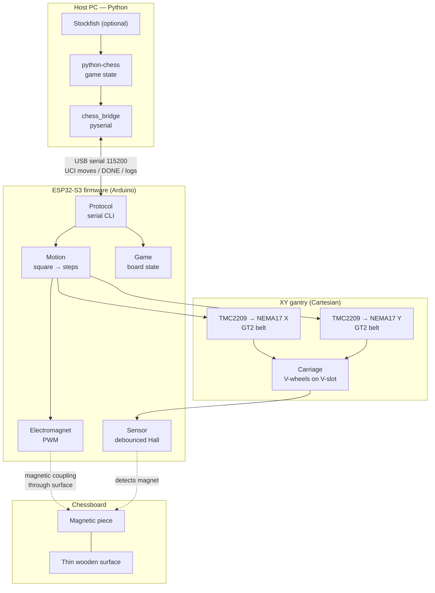

# Autonomous Robotic Chessboard

**An open-source chessboard that moves its own pieces** — an ESP32-S3 drives a custom XY gantry beneath a thin wooden board, dragging magnetically-coupled chess pieces with an electromagnet while a Hall-effect sensor verifies piece presence. Python chess software (python-chess + optional Stockfish) plans the game and commands the firmware over USB serial.

> Status: **active development.** Motion, sensing, and software subsystems are working and experimentally validated; full-game autonomy is still being integrated. See [Development Status](docs/development-status.md) for an honest breakdown of what works, what is experimental, and what is planned.

---

## Overview

Building a machine that plays physical chess raises a distinct set of embedded-systems and robotics problems that this project tackles end-to-end:

- **Coordinate mapping** — translating algebraic chess squares (`e2`, `f3`) into stepper-motor step counts on a physical gantry
- **Open-loop motion accuracy** — positioning repeatability without encoders, using calibration, acceleration ramps, and dead-reckoned position tracking
- **Magnetic actuation through a surface** — moving pieces on top of the board with an electromagnet moving underneath it
- **Piece detection** — reliably sensing magnets through the board with a Hall-effect sensor
- **Physical path planning** — knights jump over pieces, bishops travel diagonals, and blocking pieces may need temporary displacement
- **System decomposition** — the MCU executes *how* to move; the host software decides *what* to move

The project is documented as an engineering log: six Architecture Decision Records (ADRs) and six formal experiment reports (EXPs) capture the reasoning and measured results behind every major subsystem.

---

## Key Features (Implemented)

- **Modular ESP32-S3 firmware** (Arduino framework, built with PlatformIO): `Sensor`, `Motor`, `Electromagnet`, `Motion`, `Board`, `Game`, `Protocol`, `Logger`, `Timer` modules wired via constructor injection
- **Calibrated XY gantry motion** — 45.1 mm square pitch, 2220 steps/square, software acceleration/deceleration ramps, per-axis direction inversion, hall-sensor offset compensation
- **UCI move execution on hardware** — send `e2e4` over serial; the carriage picks up the piece, transports it, and places it, replying `DONE`
- **Piece-specific path strategies** — knights navigate along grid lines (between squares) for clearance; bishops move via simultaneous dual-axis diagonal stepping
- **Debounced Hall-effect piece detection** — 5 consecutive samples at 10 ms before a state change is accepted
- **Electromagnet actuation** via MOSFET driver, PWM-adjustable strength in the main firmware (LEDC, 1 kHz, 8-bit)
- **Interactive serial command CLIs** for every subsystem (motor enable, magnet toggle, square targeting, surrounds, diagnostics)
- **Python chess stack** — `python-chess` game state, deterministic heuristic move ranking with persistent user preferences, optional Stockfish integration with graceful fallback
- **`chess_bridge` host application** — connects Stockfish/python-chess to the firmware over pyserial, auto-detects the board's serial port, and orchestrates robot-vs-human games (robot plays White)
- **21 pytest unit tests** covering game logic, move ranking, preference persistence, and engine fallback
- **Engineering documentation** — ADR-001…006, EXP-001…006, architecture, hardware, firmware, and software docs

---

## System Architecture



**Responsibility split:** the ESP32-S3 owns real-time behavior — step generation, electromagnet PWM, sensor debouncing, and safe motion. The host owns chess logic — legality, engine search, game state, and high-level commands. The boundary is a simple line-based serial protocol (UCI moves and status commands).

---

## Hardware

| Component | Model / Detail | Status |
|---|---|---|
| Microcontroller | ESP32-S3 DevKitC N16R8 (USB CDC serial) | Tested |
| Stepper motors | 2× NEMA17 17HS4401 | Tested |
| Stepper drivers | 2× TMC2209 StepStick V2 (STEP/DIR mode, Vref 0.75 V) | Tested |
| Power | 12 V DC supply (motors + electromagnet), 100 µF cap across VM/GND | Tested |
| XY gantry | Custom Cartesian frame: V-slot aluminium extrusions, V-wheel carriage, GT2 belts and pulleys | Prototype, calibrated |
| Piece detection | Hall-effect sensor module, GPIO4, active-low | Tested |
| Piece actuation | 12 V electromagnet + MOSFET driver, GPIO39 | Control validated; holding-force verification in progress |
| Chess pieces | Neodymium magnet in each base (2×10 mm in pawns) | Tested |
| Endstops | — | Planned (open-loop homing assumed for now) |

**Mechanical concept:** the chessboard is a thin passive surface. All electronics ride on a carriage *below* the board: the electromagnet drags pieces above it via magnetic coupling through the wood, and the Hall sensor verifies occupancy as the carriage visits squares.

**Key calibration values** (see [docs/hardware.md](docs/hardware.md) and [EXP-006](docs/experiments/EXP-006-movement-calibration.md)):

| Parameter | Value |
|---|---|
| Square pitch | 45.1 mm |
| Steps per square | 2220 (X and Y) |
| Hall sensor Y-offset from electromagnet | 15.0 mm (compensated in software) |
| Home/center position | (3.5, 3.5) in zero-based square units |

**Pin map** (movement sketch / gantry wiring):

| Pin | Function |
|---|---|
| GPIO4 | Hall sensor (active-low) |
| GPIO8 / 9 / 10 | X motor STEP / DIR / EN |
| GPIO16 / 17 / 18 | Y motor STEP / DIR / EN |
| GPIO39 | Electromagnet (MOSFET) |
| USB | Serial console, 115200 baud |

> Note: `include/config.h` of the main firmware currently lists the X/Y pin groups transposed relative to the calibrated gantry wiring above — tracked as a known issue in [docs/development-status.md](docs/development-status.md).

---

## Software and Firmware

### Firmware (`src/` — main modular firmware)

| Module | Responsibility |
|---|---|
| `logger` / `timer` | Serial logging; non-blocking periodic timer |
| `sensor` | Debounced Hall-effect reading (5 samples @ 10 ms) |
| `board` | Sensor state change reporting + heartbeat |
| `motor` | STEP/DIR generation with blocking move profiles |
| `electromagnet` | PWM control (LEDC channel, adjustable duty) |
| `motion` | Chess-square kinematics: square ⇄ steps, pickup/place, scan-square |
| `game` | 8×8 piece board model, move application, ASCII rendering |
| `protocol` | Line-based serial command interpreter |
| `main` | Composition root wiring all modules |

### Active development firmware (`sketches/movement/`)

A self-contained sketch that currently runs the physical board: calibrated positioning with acceleration ramps, sensor-mode offset, surround parking positions, and **UCI move execution** (`e2e4`) with knight grid-line navigation and bishop diagonal motion, ending each move with `DONE` (consumed by `chess_bridge`). The remaining sketches under `sketches/` are preserved hardware experiments — motor bring-up, calibration tools, sensor tests, and path-planning prototypes (see each directory).

### Python software (`software/`)

- **`virtual_chess/`** — validated CLI prototype of the move-search workflow: ranks legal moves with deterministic heuristics (+ user-preference learning from played sessions), optional Stockfish for the engine side, 21 pytest tests
- **`chess_bridge/`** — the host application that closes the loop with the physical board: auto-detects the serial port, drives the robot's White moves via Stockfish/fallback, accepts human Black moves at the terminal

---

## Repository Structure

```
Autonomous-Robotic-Chessboard/
├── README.md                       # this file
├── LICENSE                         # MIT
├── Makefile                        # flash / bridge / test-knight targets
├── platformio.ini                  # ESP32-S3 build config (main firmware)
├── run                             # build + flash + monitor helper script
├── include/
│   └── config.h                    # firmware pin assignments & constants
├── src/                            # main firmware (modular architecture)
├── lib/                            # PlatformIO local libraries (reserved)
├── sketches/                       # hardware experiment sketches (PIO projects)
│   ├── motor_calibration/          #   manual step/direction validation
│   ├── chess_positioner/           #   single-axis square targeting
│   ├── sensor_test/                #   sensing during motion
│   ├── dual_motor_test/            #   two-axis bring-up
│   ├── engine_simulation/          #   move sequence with sensor offset
│   ├── piece_offset/               #   obstacle-displacement sequencing
│   ├── movement/                   #   ACTIVE: calibrated motion + UCI moves
│   ├── scan_test/                  #   board-scanning skeleton
│   ├── bishop_diagonal/            #   simultaneous-axis diagonal experiment
│   └── knight_offset/              #   knight obstacle-clearance experiment
├── software/
│   ├── virtual_chess/              # validated prototype + tests
│   └── chess_bridge/               # serial bridge to hardware
└── docs/
    ├── README.md                   # documentation index
    ├── architecture.md             # system & physical architecture
    ├── hardware.md                 # components, pins, calibration
    ├── firmware.md                 # firmware modules as implemented
    ├── software.md                 # Python components
    ├── communication.md            # implemented protocol + draft spec
    ├── development-status.md       # implemented / experimental / in-progress
    ├── roadmap.md                  # project phases
    ├── firmware_architecture.md    # aspirational next-gen firmware design
    ├── state_machine.md            # current control flow (formal FSM planned)
    ├── decisions/                  # ADR-001 … ADR-006
    └── experiments/                # EXP-001 … EXP-006
```

---

## Getting Started

### Prerequisites

- [PlatformIO](https://platformio.org/) CLI (`pip install platformio` or the VS Code extension) with the `espressif32` platform
- Python 3.11+
- Stockfish (optional — set `STOCKFISH_PATH` if installed)
- ESP32-S3 board connected via USB

### Build & flash firmware

```bash
# Main modular firmware (repo root project)
pio run                      # build only
pio run -t upload            # build + flash
pio device monitor           # serial monitor (115200)

# Active movement firmware (recommended for the current hardware)
pio run -d sketches/movement -t upload
pio device monitor -d sketches/movement
```

The `run` script at the repo root performs build + upload + monitor for the main firmware. The `Makefile` provides `make flash` (movement sketch), `make bridge`, and `make test-knight`.

### Play via the bridge (robot plays White)

```bash
python3 -m venv .venv && source .venv/bin/activate
pip install -r software/chess_bridge/requirements.txt
python software/chess_bridge/main.py              # auto-detects the serial port
# or: python software/chess_bridge/main.py /dev/cu.usbmodem101
```

Moves are entered in UCI (e.g. `e7e5`); `q` quits. Requires the movement sketch flashed and the board powered.

### Virtual chess prototype (no hardware needed)

```bash
cd software/virtual_chess
python3 -m venv .venv && source .venv/bin/activate
pip install -r requirements.txt
python main.py
```

### Run the Python tests

```bash
cd software/virtual_chess
source .venv/bin/activate
pip install pytest
pytest tests/ -v
```

---

## Development Status

An honest snapshot — details and evidence in [docs/development-status.md](docs/development-status.md).

**Implemented and exercised on hardware**
- XY gantry motion with square-level accuracy (calibrated, [EXP-006](docs/experiments/EXP-006-movement-calibration.md))
- Hall-effect sensing with debounce ([EXP-002](docs/experiments/EXP-002-dual-hall-sensor.md), [ADR-006](docs/decisions/ADR-006-single-hall-sensor.md))
- TMC2209/NEMA17 motor control ([EXP-004](docs/experiments/EXP-004-motor-control-validation.md), [ADR-004](docs/decisions/ADR-004-motion-driver.md))
- Electromagnet control electronics ([EXP-005](docs/experiments/EXP-005-electromagnet-control-test.md))
- Serial command CLIs and UCI move execution in the movement sketch
- Virtual chess prototype + full pytest suite ([EXP-003](docs/experiments/EXP-003-virtual-chess.md))

**Under development**
- Full-game integration via `chess_bridge` (initial serial sessions completed; end-to-end game validation ongoing)
- Electromagnet physical holding force (power-delivery debug, see EXP-005)
- Bishop diagonal and knight obstacle-clearance motion strategies (`sketches/bishop_diagonal/`, `sketches/knight_offset/` — experimental, formal reports pending)
- Board scanning (`sketches/scan_test/` is a skeleton; scan command exists in main firmware)

**Planned**
- Endstops and homing (currently open-loop from an assumed start position)
- Full-board scan integrated into the game loop (verify every move physically)
- General collision-aware path planner (temporary piece displacement for blocked paths)
- Automated captures, castling, promotion, and captured-piece removal
- Convergence of the movement sketch back into the modular `src/` firmware
- CAD/mechanical design files publication
- GUI / web interface; binary framed protocol (draft in [docs/communication.md](docs/communication.md))

---

## Engineering Challenges

- **Coordinate mapping & calibration** — square pitch (45.1 mm) and steps/square (2220) were measured empirically ([EXP-006]); the Hall sensor sits 15 mm off the electromagnet axis, so "sensor mode" targets compensate by a Y offset. Surrounds (parking lanes outside the playing area) were adjusted from the ideal 0.25-unit margin to match the physical frame.
- **Open-loop positioning** — no encoders or endstops yet; accuracy relies on calibrated step counts, acceleration ramps to avoid missed steps, and consistent dead-reckoned position tracking. Homing via endstops is the top roadmap priority.
- **Magnetic coupling through the board** — validated early ([EXP-001](docs/experiments/EXP-001-magnetic-coupling.md)) that a magnet below the surface drags one above it; coupling limits (board thickness, speed, payload) are not yet formally characterized.
- **Sensing next to an actuator** — the electromagnet can disturb Hall readings; ADR-005 requires readings to be taken with the actuator off.
- **Obstacle avoidance** — a knight leaving g1 must clear the f2/g7 pawns. Implemented strategy: travel along grid lines (borders between squares) maximizing clearance; experiments also explore temporarily displacing blocking pieces and restoring them afterward (`sketches/piece_offset/`, `sketches/knight_offset/`).
- **Diagonal motion** — bishops require synchronized X/Y stepping; implemented via interleaved step pulses with shared acceleration ramps (`moveDiagonal` in the movement sketch and `sketches/bishop_diagonal/`).
- **Host–device protocol** — currently a simple line-based text protocol (UCI in, `DONE`/logs out). A binary framed protocol with CRC and sequence numbers is drafted in [docs/communication.md](docs/communication.md) for later.

---

## Roadmap

1. **Close the loop** — end-to-end bridge games with sensor-verified moves
2. **Endstops + homing** — eliminate assumed start positions
3. **Firmware consolidation** — port calibrated movement logic into the modular `src/` firmware
4. **General path planner** — piece-aware routing for all piece types, including temporary displacement
5. **Special moves** — captures, castling, promotion, captured-piece management
6. **Documentation** — experiment reports for the bishop/knight strategies; publish CAD files
7. **Polish** — GUI/web front end, configurable engine strength, framed binary protocol

Full phase history in [docs/roadmap.md](docs/roadmap.md).

---

## Documentation

- [Documentation index](docs/README.md)
- [Architecture](docs/architecture.md) · [Hardware](docs/hardware.md) · [Firmware](docs/firmware.md) · [Software](docs/software.md)
- [Communication protocol](docs/communication.md) · [Development status](docs/development-status.md) · [Roadmap](docs/roadmap.md)
- [Architecture Decision Records (ADR-001…006)](docs/decisions/) · [Experiment Reports (EXP-001…006)](docs/experiments/)

---

## Author

**Michail Effraim Baltzis**

GitHub: [https://github.com/MikeBaltz](https://github.com/MikeBaltz)

## License

Released under the [MIT License](LICENSE).
