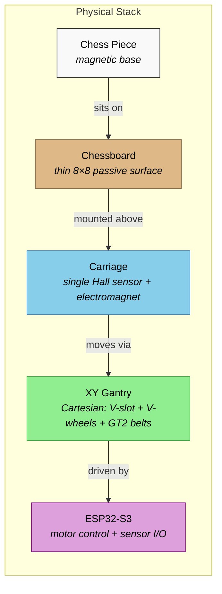
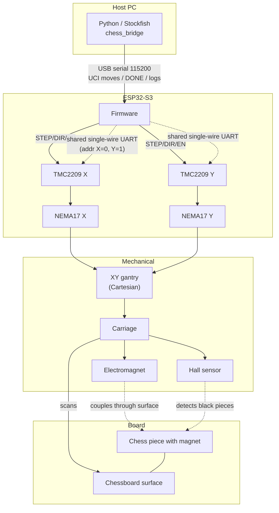

# Architecture

Current prototype architecture for the autonomous chessboard.

---

## Physical Stack



The board surface is passive — every sensor and actuator rides on a carriage underneath. The electromagnet drags pieces on the surface via magnetic coupling through the wood; the single-polarity Hall sensor detects black pieces (white pieces read as empty).

---

## System Architecture



---

## Responsibility Split

### ESP32-S3 Firmware (current)

- Sensor reading and debouncing (single Hall sensor)
- Motor step generation with acceleration ramps (both axes)
- Chess-square kinematics (square ⇄ steps, sensor offset compensation)
- Electromagnet actuation (pickup/place)
- Serial command protocol (UCI moves, positioning, diagnostics)
- Single-square scan primitives (`scan e4`, `scanpos x y`) returning one occupancy reading each
- Homing (in progress — StallGuard sensorless homing via TMC2209 DIAG, no endstop switches)

### Python / Host Software (current)

- Chess rules and move validation (python-chess)
- Stockfish integration (optional, with fallback selector)
- Game state management, move history, results
- Serial orchestration of physical moves (chess_bridge)
- Decomposition of captures, en passant, castling and promotion into firmware primitives (`g`, `path`, `o`/`O`, UCI)
- Capture-lane ledger (L1–L8 white pieces, R1–R8 black pieces)
- Detecting the human's move with smart scanning (see below)
- User interface (terminal)
- Physical path-planning policy inputs (piece-specific strategies in firmware)

ESP32-S3 decides *how* to move. Python decides *what* to move.

---

## Sensing (single Hall sensor)

Per [ADR-006](decisions/ADR-006-single-hall-sensor.md) and its single-polarity update, one Hall sensor responds to one magnet polarity only:

- Black piece on the square → magnet detected
- White piece or empty square → reads empty
- Piece identity (and white pieces in general) is tracked in software game state

**Smart scanning.** Every legal black move predicts exactly which squares hold black pieces afterwards. The bridge scans one square at a time, always for the highest-ranked candidate move that still fits every reading so far, so a typical move is identified in 2–10 scans. A move is accepted only if no other legal move fits the readings. If several still fit (for example the piece chosen for a promotion), the player picks one; if none fits, the player types the move.

The earlier dual-sensor polarity design ([ADR-002](decisions/ADR-002-dual-hall-polarity-detection.md)) was validated experimentally (EXP-002) but retired as unnecessary complexity.

---

## Motion Chain (built)

```
ESP32-S3 → TMC2209 X → NEMA17 X ─┐
                                   ├→ XY gantry (Cartesian) → Carriage
ESP32-S3 → TMC2209 Y → NEMA17 Y ─┘
```

Two independent belt-driven axes (GT2 belts and pulleys on V-slot aluminium extrusions with V-wheel carriages). Each motor owns one axis; X and Y move independently, or in interleaved lockstep for diagonal paths. Motion validation: [EXP-004](experiments/EXP-004-motor-control-validation.md); calibration: [EXP-006](experiments/EXP-006-movement-calibration.md). The gantry is Cartesian XY: one motor per axis.
