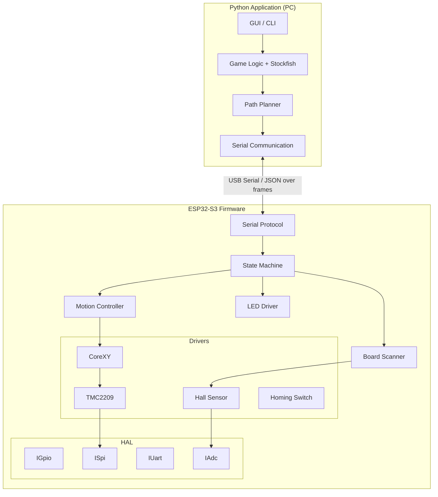
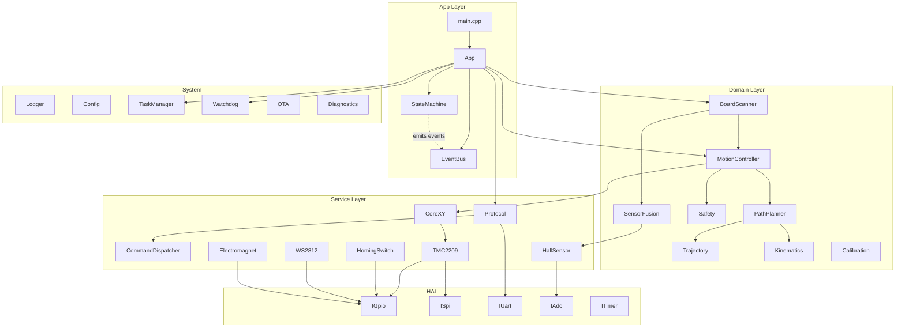
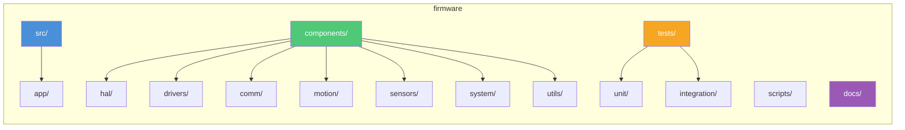
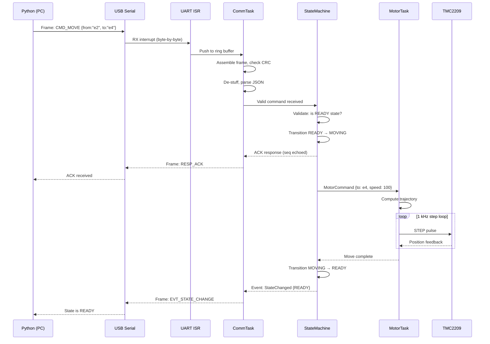
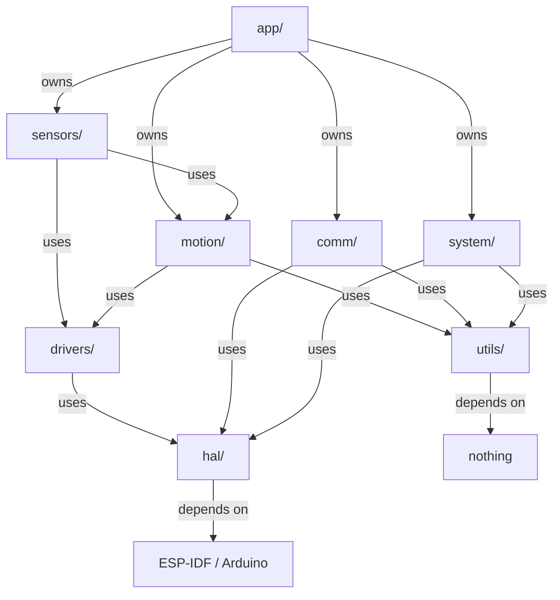

# Autonomous Chessboard — Firmware Architecture

**Author:** Lead Firmware Architect  
**Date:** 2026-07-31  
**Target:** ESP32-S3 DevKitC N16R8  
**Build system:** PlatformIO / ESP-IDF  
**Language:** C++17  

---

## Table of Contents

1. [Architecture Overview](#1-architecture-overview)
2. [Folder Structure](#2-folder-structure)
3. [Module Responsibilities](#3-module-responsibilities)
4. [Inter-Module Communication Rules](#4-inter-module-communication-rules)
5. [State Machine](#5-state-machine)
6. [Serial Communication Protocol](#6-serial-communication-protocol)
7. [ESP32 vs Python Responsibility Split](#7-esp32-vs-python-responsibility-split)
8. [Core Abstractions & Interfaces](#8-core-abstractions--interfaces)
9. [Classes That Must Exist from Day One](#9-classes-that-must-exist-from-day-one)
10. [Naming Conventions](#10-naming-conventions)
11. [SOLID Principles Application](#11-solid-principles-application)
12. [Hardware Isolation Strategy](#12-hardware-isolation-strategy)
13. [FreeRTOS Task Architecture](#13-freertos-task-architecture)
14. [Extensibility Points](#14-extensibility-points)
15. [Diagrams](#15-diagrams)

---

## 1. Architecture Overview

### Design Philosophy

The firmware is designed as a **layered, event-driven, real-time control system**. Every hardware peripheral is abstracted behind a stable interface. The application layer knows nothing about ESP32 registers or Arduino APIs — it operates on domain objects like `ChessMove`, `BoardPosition`, and `MotorCommand`.

```
┌─────────────────────────────────────────────┐
│              Application Layer               │
│   (State Machine, Orchestration, Events)     │
├─────────────────────────────────────────────┤
│              Domain Layer                     │
│   (Chess Mappings, Kinematics, Trajectory)   │
├─────────────────────────────────────────────┤
│              Service Layer                    │
│   (Drivers, Comm Protocol, Sensors)           │
├─────────────────────────────────────────────┤
│              HAL (Hardware Abstraction)       │
│   (GPIO, SPI, UART, I2C, ADC, Timer)         │
├─────────────────────────────────────────────┤
│              Platform (ESP-IDF / Arduino)     │
└─────────────────────────────────────────────┘
```

Each layer only depends on the layer directly below it. No upward dependencies. No circular dependencies.

### Design Constraints

| Constraint | Decision |
|---|---|
| Real-time motor control | Dedicated FreeRTOS task at high priority |
| Non-blocking comms | All serial I/O uses DMA + ring buffers |
| Testable without hardware | MockHAL for every peripheral interface |
| Configurable without recompile | NVS-stored settings, command-line overrides |

---

## 2. Folder Structure

```
firmware/
├── platformio.ini                  # PlatformIO build config
├── sdkconfig                       # ESP-IDF Kconfig overrides (if ESP-IDF)
├── partitions.csv                  # Flash partition table
├── CMakeLists.txt                  # Top-level CMake (ESP-IDF mode)
│
├── lib/                            # PlatformIO library dependencies
│   └── README.md
│
├── src/                            # Application entry point
│   ├── main.cpp                    # app_main() — tiny, only creates App
│   └── app/
│       ├── app.hpp
│       ├── app.cpp                 # Owns the state machine & task loop
│       ├── state_machine.hpp
│       ├── state_machine.cpp
│       ├── events.hpp              # Event type definitions
│       └── event_bus.hpp           # Publish/subscribe event dispatcher
│
├── components/                     # ESP-IDF components (also work in PlatformIO)
│   ├── hal/                        # ── Hardware Abstraction Layer ──
│   │   ├── CMakeLists.txt
│   │   ├── include/hal/
│   │   │   ├── hal.hpp             # Central HAL header, factory functions
│   │   │   ├── igpio.hpp
│   │   │   ├── ispi.hpp
│   │   │   ├── iuart.hpp
│   │   │   ├── ii2c.hpp
│   │   │   ├── iadc.hpp
│   │   │   └── itimer.hpp
│   │   └── src/
│   │       ├── esp32/
│   │       │   ├── gpio_esp32.cpp
│   │       │   ├── spi_esp32.cpp
│   │       │   ├── uart_esp32.cpp
│   │       │   ├── i2c_esp32.cpp
│   │       │   ├── adc_esp32.cpp
│   │       │   └── timer_esp32.cpp
│   │       └── mock/               # Unit-test mocks (same interfaces)
│   │           ├── gpio_mock.cpp
│   │           ├── spi_mock.cpp
│   │           ├── uart_mock.cpp
│   │           ├── i2c_mock.cpp
│   │           ├── adc_mock.cpp
│   │           └── timer_mock.cpp
│   │
│   ├── drivers/                    # ── Device Drivers ──
│   │   ├── CMakeLists.txt
│   │   ├── include/drivers/
│   │   │   ├── imotor_driver.hpp   # Abstract motor driver interface
│   │   │   ├── tmc2209.hpp
│   │   │   ├── corexy.hpp          # CoreXY gantry abstraction (2 motors)
│   │   │   ├── hall_sensor.hpp
│   │   │   ├── homing_switch.hpp
│   │   │   ├── ws2812.hpp
│   │   │   └── electromagnet.hpp
│   │   └── src/
│   │       ├── tmc2209.cpp
│   │       ├── corexy.cpp
│   │       ├── hall_sensor.cpp
│   │       ├── homing_switch.cpp
│   │       ├── ws2812.cpp
│   │       └── electromagnet.cpp
│   │
│   ├── comm/                       # ── Serial Communication ──
│   │   ├── CMakeLists.txt
│   │   ├── include/comm/
│   │   │   ├── protocol.hpp        # Public API: sendCommand(), onResponse()
│   │   │   ├── frame.hpp           # Frame encode/decode
│   │   │   ├── command_codes.hpp   # Enum of all command IDs
│   │   │   ├── command_dispatcher.hpp
│   │   │   ├── response_builder.hpp
│   │   │   ├── crc16.hpp
│   │   │   └── types.hpp           # Payload structs (MoveCmd, StatusResp…)
│   │   └── src/
│   │       ├── protocol.cpp
│   │       ├── frame.cpp
│   │       ├── command_dispatcher.cpp
│   │       ├── response_builder.cpp
│   │       └── crc16.cpp
│   │
│   ├── motion/                     # ── Motion Planning & Control ──
│   │   ├── CMakeLists.txt
│   │   ├── include/motion/
│   │   │   ├── imotion_controller.hpp
│   │   │   ├── motion_controller.hpp
│   │   │   ├── path_planner.hpp    # Converts chess moves → waypoints
│   │   │   ├── trajectory.hpp      # S-curve acceleration profile
│   │   │   ├── kinematics.hpp      # CoreXY forward/inverse kinematics
│   │   │   └── safety.hpp          # Soft limits, collision guard
│   │   └── src/
│   │       ├── motion_controller.cpp
│   │       ├── path_planner.cpp
│   │       ├── trajectory.cpp
│   │       ├── kinematics.cpp
│   │       └── safety.cpp
│   │
│   ├── sensors/                    # ── Sensor Management ──
│   │   ├── CMakeLists.txt
│   │   ├── include/sensors/
│   │   │   ├── iboard_scanner.hpp
│   │   │   ├── board_scanner.hpp
│   │   │   ├── sensor_fusion.hpp   # Combine hall + limit switch data
│   │   │   └── calibration.hpp     # Auto-calibration routines
│   │   └── src/
│   │       ├── board_scanner.cpp
│   │       ├── sensor_fusion.cpp
│   │       └── calibration.cpp
│   │
│   ├── system/                     # ── System Services ──
│   │   ├── CMakeLists.txt
│   │   ├── include/system/
│   │   │   ├── config.hpp          # NVS-backed persistent config
│   │   │   ├── logger.hpp          # Ring-buffered, level-filtered log
│   │   │   ├── task_manager.hpp    # Central FreeRTOS task registry
│   │   │   ├── watchdog.hpp        # Task watchdog + HW watchdog
│   │   │   ├── ota.hpp             # Over-the-air firmware updates
│   │   │   └── diagnostics.hpp     # Health checks, memory stats
│   │   └── src/
│   │       ├── config.cpp
│   │       ├── logger.cpp
│   │       ├── task_manager.cpp
│   │       ├── watchdog.cpp
│   │       ├── ota.cpp
│   │       └── diagnostics.cpp
│   │
│   └── utils/                      # ── General Utilities ──
│       ├── CMakeLists.txt
│       ├── include/utils/
│       │   ├── result.hpp          # Rust-style Result<T,E>
│       │   ├── circular_buffer.hpp
│       │   ├── ring_buffer.hpp
│       │   ├── math_utils.hpp
│       │   ├── time_utils.hpp
│       │   └── non_copyable.hpp
│       └── src/
│           ├── circular_buffer.cpp
│           └── ring_buffer.cpp
│
├── tests/                          # Unit & integration tests
│   ├── CMakeLists.txt
│   ├── unit/
│   │   ├── test_frame.cpp
│   │   ├── test_crc16.cpp
│   │   ├── test_kinematics.cpp
│   │   ├── test_trajectory.cpp
│   │   ├── test_state_machine.cpp
│   │   ├── test_command_dispatcher.cpp
│   │   └── test_circular_buffer.cpp
│   └── integration/
│       ├── test_comm_loopback.cpp
│       ├── test_motion_sim.cpp
│       └── test_sensor_sim.cpp
│
├── scripts/
│   ├── flash.sh
│   ├── monitor.sh
│   ├── build.sh
│   └── ota_upload.py
│
└── docs/
    ├── firmware_architecture.md    # ← This document
    ├── protocol_spec.md
    └── pinout.md
```

---

## 3. Module Responsibilities

### 3.1 `src/app/` — Application Layer

| File | Responsibility |
|---|---|
| `main.cpp` | Entry point. Creates `App` instance. Calls `app.run()`. Nothing else. |
| `app.hpp/cpp` | Owns the state machine, event bus, and all service singletons. Wires dependencies together (composition root). Starts FreeRTOS tasks. |
| `state_machine.hpp/cpp` | Finite state machine. Defines all states and legal transitions. Rejects illegal transitions. Emits events on entry/exit. |
| `events.hpp` | Struct definitions for every event in the system: `MotorStallEvent`, `CommandReceivedEvent`, `LimitSwitchEvent`, `CalibrationCompleteEvent`, etc. |
| `event_bus.hpp` | Thread-safe publish/subscribe. Any module can emit an event; any module can subscribe. Decouples producers from consumers. |

### 3.2 `components/hal/` — Hardware Abstraction Layer

Every HAL interface follows the same pattern:

```
┌──────────────┐     ┌───────────────────┐
│  Driver      │────▶│  IInterface       │  (pure virtual)
│  (consumer)  │     │  (abstract base)  │
└──────────────┘     └───────┬───────────┘
                             │ implements
                    ┌────────▼───────────┐    ┌──────────────────┐
                    │  Esp32Impl         │    │  MockImpl        │
                    │  (real hardware)   │    │  (unit tests)    │
                    └────────────────────┘    └──────────────────┘
```

| Interface | Purpose |
|---|---|
| `IGpio` | Digital I/O read/write, interrupt attach |
| `ISpi` | SPI bus transactions (used by TMC2209) |
| `IUart` | UART send/receive with DMA (USB Serial) |
| `II2c` | I²C master (future: temp sensors, I/O expanders) |
| `IAdc` | Analog read (hall sensors) |
| `ITimer` | Hardware timer callbacks, micros/millis |

The HAL is the **only** place where `#include <driver/gpio.h>` or Arduino `digitalWrite()` appears. Every higher layer depends on interfaces, not ESP32 specifics.

### 3.3 `components/drivers/` — Device Drivers

| Driver | Responsibility |
|---|---|
| `IMotorDriver` | Abstract interface: `init()`, `moveTo()`, `stop()`, `getPosition()`, `setCurrent()` |
| `TMC2209` | Implements `IMotorDriver` for TMC2209 via UART or STEP/DIR. Handles stall detection (StallGuard). Configures microstepping, current. |
| `CoreXY` | Owns **two** `IMotorDriver*`. Converts Cartesian (x,y) → motor A/B steps using CoreXY kinematics. Provides `moveTo(x_mm, y_mm, speed)`. |
| `HallSensor` | Reads a single analog hall sensor. Configurable threshold. Provides `isPiecePresent()` / `readStrength()`. |
| `HomingSwitch` | Reads an endstop / limit switch. Debounced. Provides `isTriggered()`. |
| `WS2812` | Drives a strip of addressable RGB LEDs via RMT peripheral. Provides `setPixel(index, r, g, b)` and `show()`. |
| `Electromagnet` | Controls the piece-lifting electromagnet via GPIO + MOSFET. Provides `engage()` / `disengage()`. PWM for variable strength. |

### 3.4 `components/comm/` — Communication

| Module | Responsibility |
|---|---|
| `Frame` | Encodes/decodes the binary wire format. Validates CRC16. Handles byte-stuffing (escape 0xAA, 0x55 sync bytes in payload). |
| `Protocol` | Stateful protocol handler. Receives raw bytes from UART ISR → assembles frames → dispatches complete commands. Sends responses/events. Handles sequence-number tracking and retransmission. |
| `CommandDispatcher` | Registry of `command_id → handler_fn`. Routes incoming commands to the correct handler. Handlers return `Response`. |
| `ResponseBuilder` | Fluent API to construct responses and events. Ensures consistent formatting. |
| `CRC16` | CRC-16-CCITT implementation (table-driven for speed). |
| `Types` | All command/response/event payload structs, enums for error codes, piece types, board squares. |

### 3.5 `components/motion/` — Motion Planning & Control

| Module | Responsibility |
|---|---|
| `IMotionController` | Abstract interface: `home()`, `moveTo(x,y)`, `pickup()`, `place()`, `emergencyStop()` |
| `MotionController` | High-level motion orchestrator. Takes a `ChessMove`, plans the sequence (move to pickup, engage magnet, lift, move to place, lower, disengage), executes each step. |
| `PathPlanner` | Converts board-square coordinates to physical (x,y) waypoints. Handles obstacle avoidance (other pieces not on the move path). Generates safe travel height for the electromagnet. |
| `Trajectory` | Generates S-curve acceleration profiles. Given start/end position and speed limits, produces a list of timed setpoints for the motor control loop. |
| `Kinematics` | Pure math. Forward kinematics: (motorA, motorB) → (x, y). Inverse kinematics: (x, y) → (motorA, motorB). Unit-tested exhaustively. |
| `Safety` | Software limits. Enforces maximum travel bounds. Monitors motor current for stalls. Triggered by limit switches. Auto-disengages on fault. All paths validated before execution. |

### 3.6 `components/sensors/` — Sensor Management

| Module | Responsibility |
|---|---|
| `IBoardScanner` | Abstract interface: `scan(board[64])`, `calibrate()` |
| `BoardScanner` | Orchestrates scanning the entire 8×8 board. Moves the gantry over each square, reads the hall sensor, records presence. Can do a quick scan (only changed squares) or full scan. |
| `SensorFusion` | Combines hall sensor, limit switch, and motor-current data to produce a unified "state of the world." Reduces false positives/negatives. |
| `Calibration` | Automatic calibration routines. Finds board corners, measures square dimensions, calibrates hall sensor thresholds for different piece types, detects magnetic vs non-magnetic pieces. Stores results in NVS. |

### 3.7 `components/system/` — System Services

| Module | Responsibility |
|---|---|
| `Config` | Key-value store backed by ESP32 NVS (non-volatile storage). Defaults in code, overridable at runtime. Provides typed getters/setters. |
| `Logger` | Ring-buffer logger with severity levels (TRACE, DEBUG, INFO, WARN, ERROR). Thread-safe. Can dump buffer over serial on request. Supports printf-style formatting. |
| `TaskManager` | Registry of all FreeRTOS tasks. Stores task handles, stack high-water marks, runtime stats. Provides `startAll()`, `suspendAll()`, `getStats()`. |
| `Watchdog` | Configures both the hardware watchdog timer and per-task software watchdogs. Each task must "pet" its watchdog periodically. Force-resets if any task hangs. |
| `OTA` | Over-the-air firmware updates. Downloads new firmware via HTTP from a configurable URL. Verifies signature. Switches to the new partition and reboots. |
| `Diagnostics` | Health-check routines: memory free, task stack usage, uptime, error counters, last reset reason. Returns structured JSON for the Python app. |

### 3.8 `components/utils/` — General Utilities

| Utility | Purpose |
|---|---|
| `Result<T,E>` | Rust-style error handling. Forces error checking at compile time. No exceptions. |
| `CircularBuffer<T,N>` | Lock-free single-producer single-consumer FIFO. Used for serial TX/RX. |
| `RingBuffer<T>` | Dynamically-allocated ring buffer with mutex protection. |
| `MathUtils` | `map()`, `constrain()`, `lerp()`, vector math, coordinate transforms. All `constexpr`. |
| `TimeUtils` | `ticks_since()`, `deadline_from_now()`, duration formatting. |
| `NonCopyable` | CRTP base class to delete copy ctor/assignment. |

---

## 4. Inter-Module Communication Rules

### Allowed Dependencies

```
app/ ──────────────── can depend on ──▶ everything
drivers/ ─────────── can depend on ──▶ hal/
comm/ ────────────── can depend on ──▶ hal/, utils/
motion/ ──────────── can depend on ──▶ drivers/, utils/
sensors/ ─────────── can depend on ──▶ drivers/, hal/, motion/, utils/
system/ ──────────── can depend on ──▶ hal/, utils/
utils/ ───────────── depends on ─────▶ nothing
hal/ ─────────────── depends on ─────▶ platform (ESP-IDF / Arduino)
```

### Forbidden Dependencies

- **No module may depend on `app/`** (except `main.cpp`). The app layer is the composition root.
- **`hal/` must not depend on any other component.**
- **`drivers/` must not depend on `motion/` or `sensors/`** (drivers are low-level).
- **No circular dependencies.** Period.

### Cross-Module Communication Patterns

| Pattern | Use Case |
|---|---|
| **Direct interface call** | When module A owns module B, calls B's public methods directly. Fastest. |
| **Event bus** | When module A should not know about module B. `EventBus::emit(MotorStallEvent{...})`. Any module can subscribe. |
| **Callback / observer** | When a module needs to notify exactly one consumer. `onCommandReceived(callback)`. |
| **Shared state (mutexed)** | When two tasks need read/write access to the same data. e.g., current position. Use `std::atomic` or `FreeRTOS mutex`. |

**Rule of thumb:** Use direct calls within a component. Use events between components. Use callbacks when the relationship is 1:1 across components.

---

## 5. State Machine

### State Definitions

| State | Meaning |
|---|---|
| `BOOT` | Power-on. RTC, clocks, basic init. Transient. |
| `INIT` | Initializing HAL, drivers, NVS, WiFi (if enabled). |
| `SELF_TEST` | Running diagnostics: motor connectivity, sensor responsiveness, memory integrity. |
| `IDLE` | All subsystems initialized. Awaiting commands. Not necessarily homed or calibrated. |
| `HOMING` | Executing homing sequence: move to limit switches, zero position. |
| `HOMED` | Position known. Ready to calibrate or operate if already calibrated. |
| `CALIBRATING` | Running board geometry calibration and sensor threshold detection. |
| `READY` | Fully operational. Position known, sensors calibrated. Can accept move/scan commands. |
| `MOVING` | Executing a motor trajectory. Cannot accept another move command. |
| `SCANNING` | Performing a board scan. Cannot accept another scan command. |
| `ERROR` | Recoverable error. System is safe but needs attention. |
| `EMERGENCY_STOP` | Hardware or software E-stop triggered. All motors disabled. Requires explicit clear. |
| `OTA` | Downloading and installing firmware update. Motors and sensors offline. |
| `SLEEP` | Low-power mode (future). |

### State Transitions

| From | To | Trigger |
|---|---|---|
| `BOOT` | `INIT` | Automatic (after RTC/clock init) |
| `INIT` | `SELF_TEST` | Automatic (after all subsystems init) |
| `SELF_TEST` | `IDLE` | All diagnostics pass |
| `SELF_TEST` | `ERROR` | Any diagnostic fails |
| `IDLE` | `HOMING` | HOME command received, or first move requested without homing |
| `IDLE` | `CALIBRATING` | CALIBRATE command received |
| `IDLE` | `READY` | (if already homed & calibrated from NVS) |
| `IDLE` | `OTA` | OTA_START command received |
| `HOMING` | `HOMED` | Homing sequence completes successfully |
| `HOMING` | `ERROR` | Homing fails (no limit switch, stall, timeout) |
| `HOMED` | `CALIBRATING` | CALIBRATE command received |
| `HOMED` | `READY` | Calibration data exists in NVS |
| `CALIBRATING` | `READY` | Calibration completes successfully |
| `CALIBRATING` | `ERROR` | Calibration fails |
| `READY` | `MOVING` | MOVE command received |
| `READY` | `SCANNING` | SCAN command received |
| `MOVING` | `READY` | Move completes successfully |
| `MOVING` | `ERROR` | Motor stall, out-of-bounds, collision |
| `SCANNING` | `READY` | Scan completes successfully |
| `SCANNING` | `ERROR` | Scan hardware failure |
| `ANY` | `EMERGENCY_STOP` | ESTOP command or hardware switch |
| `ANY` | `ERROR` | Watchdog timeout, critical fault |
| `EMERGENCY_STOP` | `IDLE` | CLEAR_ESTOP command |
| `ERROR` | `IDLE` | RESET command, or automatic recovery |
| `ERROR` | `BOOT` | System reset (software reboot) |

### State Entry/Exit Actions

Each state has enforced `onEnter()` and `onExit()` hooks:
- `onEnter()`: initialize resources, start timers, emit `StateEnteredEvent`
- `onExit()`: clean up resources, stop timers, emit `StateExitedEvent`

Transitions are atomic: the state only changes after `onExit(old)` succeeds AND `onEnter(new)` succeeds. If either fails, transition to `ERROR`.

---

## 6. Serial Communication Protocol

### 6.1 Physical Layer

- **Transport:** USB CDC ACM (USB Serial) at 921600 baud (or 115200 fallback)
- **On ESP32:** UART via USB-Serial-JTAG or external USB-UART
- **Flow control:** Software (XON/XOFF) — optional, disabled by default

### 6.2 Frame Format

```
┌──────────┬──────────┬──────────┬──────────┬──────────┬──────────────┬──────────┐
│  SYNC0   │  SYNC1   │  LENGTH  │  TYPE    │   SEQ    │   PAYLOAD    │  CRC16   │
│  0xAA    │  0x55    │ 2 bytes  │  1 byte  │  1 byte  │  0..N bytes  │ 2 bytes  │
│  1 byte  │  1 byte  │ (LE)     │          │          │              │  (LE)    │
└──────────┴──────────┴──────────┴──────────┴──────────┴──────────────┴──────────┘
```

| Field | Size | Description |
|---|---|---|
| SYNC0 | 1 | Start byte 0: `0xAA` |
| SYNC1 | 1 | Start byte 1: `0x55` |
| LENGTH | 2 | Payload length in bytes (0–2048), little-endian |
| TYPE | 1 | Message type (see below) |
| SEQ | 1 | Sequence number (0–255), wraps. Responses echo command SEQ. |
| PAYLOAD | N | Type-specific data (JSON string, UTF-8) |
| CRC16 | 2 | CRC-16-CCITT over TYPE + SEQ + PAYLOAD, little-endian |

### 6.3 Message Types

**TYPE byte — upper nibble = category, lower nibble = direction**

| Value | Name | Direction | Meaning |
|---|---|---|---|
| `0x10` | CMD_MOVE | PC→ESP32 | Execute a chess move |
| `0x11` | CMD_HOME | PC→ESP32 | Start homing sequence |
| `0x12` | CMD_SCAN | PC→ESP32 | Scan the board |
| `0x13` | CMD_CALIBRATE | PC→ESP32 | Start calibration |
| `0x14` | CMD_GET_STATUS | PC→ESP32 | Request status dump |
| `0x15` | CMD_ESTOP | PC→ESP32 | Emergency stop |
| `0x16` | CMD_RESET | PC→ESP32 | Software reset |
| `0x17` | CMD_SET_LED | PC→ESP32 | Set LED color(s) |
| `0x18` | CMD_OTA_START | PC→ESP32 | Begin OTA update |
| `0x19` | CMD_OTA_DATA | PC→ESP32 | OTA data chunk |
| `0x1A` | CMD_OTA_FINISH | PC→ESP32 | Complete OTA |
| `0x1B` | CMD_GET_DIAGNOSTICS | PC→ESP32 | Request diagnostics JSON |
| | | | |
| `0x20` | RESP_ACK | ESP32→PC | Command accepted |
| `0x21` | RESP_NACK | ESP32→PC | Command rejected (with error code) |
| `0x22` | RESP_BOARD_STATE | ESP32→PC | 64-byte board array (scan result) |
| `0x23` | RESP_STATUS | ESP32→PC | Current state, position, flags |
| `0x24` | RESP_DIAGNOSTICS | ESP32→PC | System diagnostics JSON |
| `0x25` | RESP_CALIBRATION | ESP32→PC | Calibration data |
| | | | |
| `0x30` | EVT_LIMIT_TRIGGERED | ESP32→PC | Limit switch activated |
| `0x31` | EVT_MOTOR_STALL | ESP32→PC | StallGuard detected stall |
| `0x32` | EVT_ERROR | ESP32→PC | Error condition |
| `0x33` | EVT_STATE_CHANGE | ESP32→PC | State machine transition |
| `0x34` | EVT_HEARTBEAT | ESP32→PC | Periodic keepalive |

### 6.4 Payload Format

All payloads are **JSON strings (UTF-8)**. This prioritizes debuggability and extensibility over raw speed. The protocol is not bandwidth-constrained (USB CDC can handle ~1 MB/s).

**Example: CMD_MOVE payload**
```json
{
  "from": "e2",
  "to": "e4",
  "move_type": "normal",
  "speed": 100
}
```

**Example: RESP_BOARD_STATE payload**
```json
{
  "board": [
    "r","n","b","q","k","b","n","r",
    "p","p","p","p","p","p","p","p",
    " "," "," "," "," "," "," "," ",
    " "," "," "," "," "," "," "," ",
    " "," "," "," "," "," "," "," ",
    " "," "," "," "," "," "," "," ",
    "P","P","P","P","P","P","P","P",
    "R","N","B","Q","K","B","N","R"
  ],
  "timestamp_ms": 12345
}
```

**Example: RESP_NACK payload**
```json
{
  "error_code": 4,
  "message": "Out of bounds: square h9 does not exist",
  "command_seq": 42
}
```

### 6.5 Error Codes

| Code | Name | Meaning |
|---|---|---|
| 0x01 | ERR_INVALID_CMD | Unknown command type |
| 0x02 | ERR_INVALID_PAYLOAD | JSON parse error or missing field |
| 0x03 | ERR_MOTOR_FAULT | TMC2209 driver error |
| 0x04 | ERR_OUT_OF_BOUNDS | Requested position outside travel limits |
| 0x05 | ERR_NOT_CALIBRATED | Calibration required before this command |
| 0x06 | ERR_NOT_HOMED | Homing required before this command |
| 0x07 | ERR_BUSY | System is in MOVING/SCANNING/HOMING state |
| 0x08 | ERR_HARDWARE | Hardware-level failure (disconnected sensor, etc.) |
| 0x09 | ERR_TIMEOUT | Operation timed out |
| 0x0A | ERR_CRC | Frame CRC mismatch |
| 0x0B | ERR_ESTOP_ACTIVE | Emergency stop is engaged |
| 0x0C | ERR_WATCHDOG | Watchdog reset imminent |
| 0x0D | ERR_OTA_FAILED | OTA update failure |

### 6.6 Sequence Numbers & Reliability

- PC increments SEQ for each command. ESP32 echoes the SEQ in the response.
- If ESP32 receives a command with the same SEQ as the last acknowledged command, it re-sends the cached response (idempotent replay).
- ESP32 may send unsolicited EVT messages with its own SEQ.
- Max one outstanding unacknowledged command at a time (stop-and-wait).

### 6.7 Byte Stuffing / COBS

To prevent sync bytes (`0xAA`, `0x55`) from appearing in payload data and causing false frame detection, the payload and CRC are encoded with **Consistent Overhead Byte Stuffing (COBS)** before transmission. The receiver de-stuffs before CRC validation.

---

## 7. ESP32 vs Python Responsibility Split

A clean split at the serial boundary is critical. Each side owns its domain and does not reach across.

### ESP32 Responsibilities (Real-Time / Hardware)

| Domain | Tasks |
|---|---|
| **Motor control** | Step generation, microstepping, acceleration profiles, stall detection |
| **Motion safety** | Software limits, collision avoidance, emergency stop |
| **Sensor I/O** | Reading hall sensors, debouncing limit switches |
| **Board scanning** | Physically moving gantry + reading sensors to build board state array |
| **LED control** | Driving WS2812 strips with precise timing |
| **Homing** | Limit switch detection, zeroing position counters |
| **Calibration** | Automated measurement of board geometry (mm/step ratios, sensor thresholds) |
| **Serial protocol** | Framing, CRC, byte-stuffing, command dispatch, sequence tracking |
| **State management** | State machine enforcement, error detection, watchdog |
| **OTA updates** | Download, flash, verify, reboot |
| **Persistent storage** | NVS read/write for calibration data and config |

### Python Responsibilities (Application / Logic)

| Domain | Tasks |
|---|---|
| **Game logic** | Chess rules, turn management, castling, en passant, promotion |
| **Move validation** | Legal move checking via Stockfish or python-chess |
| **Game state** | Full board representation, move history, FEN generation |
| **Path planning** | Which sequence of physical moves to execute (castling = 2 movements, captured piece removal, etc.) |
| **Strategy** | Stockfish engine for AI opponent |
| **User interface** | CLI, GUI, or web interface |
| **Game modes** | Human vs Human, Human vs AI, AI vs AI |
| **Serial communication** | Frame encoding/decoding, command sequencing, timeout handling |
| **Logging & analytics** | Game recording, PGN export, performance stats |
| **Configuration** | User preferences for speed, LED colors, AI difficulty |

### What Python NEVER Does

- Python never generates step pulses or controls motor timing directly.
- Python never reads raw sensor values.
- Python never knows the physical coordinate system (only chess-square coordinates).
- Python never handles emergency stops (ESP32 does this autonomously).

### What ESP32 NEVER Does

- ESP32 never validates chess rules. It moves what it's told.
- ESP32 never runs a chess engine. It has no concept of "legal move."
- ESP32 never decides strategy. It is a motion executor only.
- ESP32 never knows the difference between a pawn and a queen (piece type is Python's domain).

### The Contract

```
Python sends:  {"from": "e2", "to": "e4", "move_type": "normal"}
ESP32 replies: {"status": "ok", "move_id": 7}
```

Python says *what* to do. ESP32 decides *how* to do it.

---

## 8. Core Abstractions & Interfaces

Every interface follows the **Interface Segregation Principle**: small, focused, single-purpose.

### 8.1 HAL Interfaces

```cpp
// ─── GPIO ───
class IGpio {
public:
    virtual ~IGpio() = default;
    virtual void setDirection(uint8_t pin, GpioMode mode) = 0;
    virtual void write(uint8_t pin, bool high) = 0;
    virtual bool read(uint8_t pin) = 0;
    virtual void attachInterrupt(uint8_t pin, GpioIntrType type,
                                 std::function<void()> callback) = 0;
};

// ─── SPI ───
class ISpi {
public:
    virtual ~ISpi() = default;
    virtual void transfer(const uint8_t* tx, uint8_t* rx, size_t len) = 0;
    virtual void setFrequency(uint32_t hz) = 0;
};

// ─── UART ───
class IUart {
public:
    virtual ~IUart() = default;
    virtual void write(const uint8_t* data, size_t len) = 0;
    virtual size_t read(uint8_t* buf, size_t maxLen, uint32_t timeoutMs) = 0;
    virtual void onDataReceived(std::function<void(const uint8_t*, size_t)> cb) = 0;
};

// ─── I²C ───
class II2c {
public:
    virtual ~II2c() = default;
    virtual void write(uint8_t addr, const uint8_t* data, size_t len) = 0;
    virtual void read(uint8_t addr, uint8_t* data, size_t len) = 0;
    virtual void writeRead(uint8_t addr, const uint8_t* tx, size_t txLen,
                           uint8_t* rx, size_t rxLen) = 0;
};

// ─── ADC ───
class IAdc {
public:
    virtual ~IAdc() = default;
    virtual uint16_t read(uint8_t channel) = 0;
    virtual void setAttenuation(uint8_t channel, AdcAtten atten) = 0;
};

// ─── Timer ───
class ITimer {
public:
    virtual ~ITimer() = default;
    virtual uint64_t micros() = 0;
    virtual uint64_t millis() = 0;
    virtual void delayUs(uint32_t us) = 0;
};
```

### 8.2 Domain Interfaces

```cpp
// ─── Motor Driver ───
class IMotorDriver {
public:
    virtual ~IMotorDriver() = default;
    virtual Result<void, MotorError> init() = 0;
    virtual Result<void, MotorError> enable(bool on) = 0;
    virtual Result<void, MotorError> moveTo(int32_t steps, uint32_t speed) = 0;
    virtual Result<void, MotorError> stepDirection(bool dir, uint32_t speed) = 0;
    virtual Result<void, MotorError> stop() = 0;
    virtual Result<int32_t, MotorError> getPosition() = 0;
    virtual Result<void, MotorError> setCurrent(uint16_t ma) = 0;
    virtual Result<bool, MotorError> isStalled() = 0;  // StallGuard
};

// ─── Motion Controller ───
class IMotionController {
public:
    virtual ~IMotionController() = default;
    virtual Result<void, MotionError> home() = 0;
    virtual Result<void, MotionError> moveToMm(float x, float y, float speed) = 0;
    virtual Result<void, MotionError> pickup() = 0;   // engage magnet
    virtual Result<void, MotionError> place() = 0;    // disengage magnet
    virtual Result<void, MotionError> executeMove(uint8_t fromSquare,
                                                   uint8_t toSquare) = 0;
    virtual Result<void, MotionError> emergencyStop() = 0;
};

// ─── Board Scanner ───
class IBoardScanner {
public:
    virtual ~IBoardScanner() = default;
    virtual Result<void, SensorError> scan(uint8_t boardState[64]) = 0;
    virtual Result<void, SensorError> scanSquare(uint8_t square,
                                                  uint8_t& piecePresent) = 0;
    virtual Result<void, SensorError> calibrate() = 0;
};

// ─── Communication ───
class ICommunication {
public:
    virtual ~ICommunication() = default;
    virtual void sendResponse(uint8_t seq, const ResponsePayload& payload) = 0;
    virtual void sendEvent(const EventPayload& payload) = 0;
    virtual void onCommand(std::function<void(uint8_t cmd, uint8_t seq,
                                               const uint8_t* data, size_t len)> cb) = 0;
};

// ─── Config ───
class IConfig {
public:
    virtual ~IConfig() = default;
    virtual Result<int32_t, ConfigError> getInt(const char* key, int32_t def) = 0;
    virtual Result<void, ConfigError> setInt(const char* key, int32_t val) = 0;
    virtual Result<float, ConfigError> getFloat(const char* key, float def) = 0;
    virtual Result<void, ConfigError> setFloat(const char* key, float val) = 0;
    virtual Result<void, ConfigError> erase(const char* key) = 0;
    virtual Result<void, ConfigError> commit() = 0;
};
```

---

## 9. Classes That Must Exist from Day One

### Priority 1 — Start the project with these (cannot defer)

| Class | Rationale |
|---|---|
| `App` | Composition root. Without this, nothing is wired together. |
| `StateMachine` | Core of all behavior. Without it, the system has no defined lifecycle. |
| `EventBus` | Decouples everything from day one. Retrofitting events is painful. |
| `Result<T,E>` | Error handling foundation. Every function returns this. Prevents ignored errors. |
| `Logger` | You cannot debug without logging. Start with ring-buffer logger. |
| `Config` | NVS-backed settings. Pin numbers, calibration data, flags. Never hardcode. |
| `Frame` | Serial protocol foundation. Even just "ACK/NACK" needs framing. |
| `CRC16` | Required by `Frame`. Small, testable in isolation. |
| `CommandDispatcher` | Routes serial commands to handlers. Extensible registry pattern. |
| `IGpio`, `ISpi`, `IUart` | HAL interfaces. Without them, drivers are coupled to ESP32. |
| `TMC2209` | The motor driver. You can't move without it. |
| `CoreXY` | Converts Cartesian → motor steps. Core kinematic logic. |
| `Kinematics` | Pure math. Easy to unit-test. Get it right early. |
| `MotionController` | High-level motion orchestration. Required by state machine. |
| `HallSensor` | Board piece detection. Required for scanning. |
| `BoardScanner` | Orchestrates board reading. Required by game loop. |
| `Safety` | Software limits, collision detection. Safety cannot be deferred. |
| `TaskManager` | FreeRTOS task registry. Start with good task hygiene. |
| `Watchdog` | Prevents firmware hangs. Critical from day one. |
| `Diagnostics` | Health checks. Needed to debug the build itself. |

### Priority 2 — Can add in week 2–3

| Class | Rationale |
|---|---|
| `Trajectory` | S-curve profiles. Can start with simple trapezoidal. |
| `PathPlanner` | Multi-waypoint planning. Can start with point-to-point. |
| `SensorFusion` | Combine sensor data. Can start with hall-only. |
| `Calibration` | Auto-calibration. Can start with hardcoded measurements. |
| `HomingSwitch` | Limit switch driver. Needed for homing but can hack initial setup. |
| `WS2812` | LED driver. Purely cosmetic, can defer. |
| `Electromagnet` | GPIO control. Simple, but piece pickup requires it. |
| `OTA` | Firmware update. Can defer until USB flashing is too inconvenient. |
| `RingBuffer`, `CircularBuffer` | Can use FreeRTOS queues initially. |

---

## 10. Naming Conventions

| Element | Convention | Example |
|---|---|---|
| File names | `snake_case.hpp` / `snake_case.cpp` | `state_machine.hpp`, `tmc2209.cpp` |
| Namespaces | `lowercase` | `namespace hal`, `namespace comm` |
| Classes / Structs | `PascalCase` | `StateMachine`, `TMC2209` |
| Interfaces (abstract) | `IPascalCase` | `IMotorDriver`, `IGpio` |
| Functions / Methods | `camelCase` | `moveToMm()`, `isStalled()` |
| Variables | `camelCase` | `currentSpeed`, `targetPosition` |
| Constants | `kPascalCase` or `UPPER_SNAKE_CASE` | `kMaxStepsPerSec`, `MAX_MOTORS` |
| Enum values | `UPPER_SNAKE_CASE` inside `enum class` | `State::HOMING`, `ErrorCode::ERR_BUSY` |
| Private members | `m_camelCase` | `m_motorA`, `m_isEnabled` |
| Static members | `s_camelCase` | `s_instance`, `s_logBuffer` |
| Macros | `UPPER_SNAKE_CASE` (avoid when possible) | `CONFIG_SERIAL_BAUD` |
| FreeRTOS tasks | `vPrefixTask` | `vMotorTask`, `vCommTask` |
| Component folders | `lowercase` | `hal/`, `drivers/`, `comm/` |
| Test files | `test_<module>.cpp` | `test_kinematics.cpp` |
| Header guards | `COMPONENT_FILE_HPP` | `MOTION_KINEMATICS_HPP` |

### Header Guard Preference

Use `#pragma once` everywhere. Supported by all modern compilers for ESP32. Less error-prone than `#ifndef` guards.

---

## 11. SOLID Principles Application

| Principle | How It's Applied |
|---|---|
| **S** — Single Responsibility | Every class has exactly one reason to change. `TMC2209` only talks to the TMC2209 IC. `Frame` only encodes/decodes. `PathPlanner` only computes waypoints. |
| **O** — Open/Closed | New motor drivers implement `IMotorDriver` — no changes to `CoreXY` or `MotionController`. New sensor types implement `ISensor` — no changes to `BoardScanner`. The `CommandDispatcher` registry allows adding commands without modifying the dispatcher itself. |
| **L** — Liskov Substitution | Every `IMotorDriver` implementation must satisfy the contract. `MockMotor` behaves identically to `TMC2209` in tests. `GpioEsp32` and `GpioMock` are interchangeable. |
| **I** — Interface Segregation | `IMotorDriver` does not include LED or sensor methods. `IUart` does not include SPI methods. Clients depend only on what they use. |
| **D** — Dependency Inversion | High-level modules (`MotionController`) depend on abstractions (`IMotorDriver*`), not concrete classes (`TMC2209`). Dependencies are injected at construction time (constructor injection). The `App` class is the composition root that wires concrete instances to interfaces. |

### Dependency Injection Approach

**No DI framework.** Manual constructor injection is sufficient for embedded systems:

```cpp
// Composition root in App::init()
auto gpio    = std::make_unique<GpioEsp32>();
auto spi     = std::make_unique<SpiEsp32>(SPI2_HOST);
auto motorA  = std::make_unique<TMC2209>(*spi, *gpio, PIN_CS_A, PIN_EN_A);
auto motorB  = std::make_unique<TMC2209>(*spi, *gpio, PIN_CS_B, PIN_EN_B);
auto corexy  = std::make_unique<CoreXY>(std::move(motorA), std::move(motorB));
auto motion  = std::make_unique<MotionController>(std::move(corexy), *safety);
```

This makes unit testing trivial: inject mocks instead of real hardware drivers.

---

## 12. Hardware Isolation Strategy

### Rule

**Only `hal/` includes platform headers.** Every other component includes only interface headers (`igpio.hpp`, not `driver/gpio.h`).

### Implementation

```
                    ┌──────────────────────┐
                    │   application code    │
                    │   motion, sensors,    │
                    │   comm, drivers...    │
                    └──────────┬───────────┘
                               │ depends on
                    ┌──────────▼───────────┐
                    │  abstract interfaces  │
                    │  IGpio, ISpi, IUart   │
                    └──────────┬───────────┘
                               │ implemented by
              ┌────────────────┼────────────────┐
              │                │                │
    ┌─────────▼──────┐  ┌─────▼──────┐  ┌──────▼─────────┐
    │  Esp32Impl     │  │  MockImpl  │  │  HostImpl      │
    │  #include ESP  │  │  (tests)   │  │  (PC testing)  │
    │  registers     │  │            │  │  #include stdio │
    └────────────────┘  └────────────┘  └────────────────┘
```

### Platform-Specific Code Isolation

- `hal/src/esp32/` — ESP-IDF and Arduino implementations.
- `hal/src/mock/` — Pure software implementations for unit tests.
- `drivers/` — Use `IGpio&`, `ISpi&` references. Never `digitalWrite()` directly.
- `system/` — `Config` uses `nvs_flash.h` but through a thin `INvs` interface so it can be mocked.

### Pin Configuration

Pin assignments live in `Config` (NVS) with compile-time defaults. Never hardcode a pin number in a driver:

```cpp
// BAD
class TMC2209 {
    static constexpr int ENABLE_PIN = 12;  // hardcoded
};

// GOOD
class TMC2209 {
    TMC2209(ISpi& spi, IGpio& gpio, uint8_t enablePin, uint8_t csPin);
};
```

---

## 13. FreeRTOS Task Architecture

### Task Layout

| Task Name | Priority | Stack | Period | Responsibility |
|---|---|---|---|---|
| `vMotorTask` | **High** (20) | 4096 | 1 kHz | Step pulse generation, trajectory following, stall monitoring. Must never miss a deadline. |
| `vCommTask` | Medium (10) | 4096 | Event-driven | Serial frame assembly, command dispatch, response sending. Wakes on UART RX interrupt. |
| `vSensorTask` | Medium (8) | 3072 | 100 Hz | Hall sensor polling, debouncing, sensor fusion. |
| `vAppTask` | Low (5) | 4096 | 10 Hz | State machine, event bus processing, diagnostics, watchdog petting. |
| `vLedTask` | Low (3) | 2048 | 30 Hz | LED animation patterns (breathing, blinking). |
| `vOtaTask` | Normal (7) | 8192 | On-demand | Created only during OTA. Large stack for TLS. Destroyed after update. |

### Inter-Task Communication

| Channel | Usage |
|---|---|
| **FreeRTOS Queues** | `MotorTask` receives `MotorCommand` structs. `CommTask` receives raw bytes from ISR. |
| **EventBus** | `AppTask` publishes `StateChangedEvent`; `LedTask` subscribes to change LED patterns. Thread-safe via FreeRTOS mutex. |
| **`std::atomic<T>`** | Current position, system state, error flags. Lock-free reads by any task. |
| **Mutex-protected state** | Calibration data, config changes. Writes are rare; reads are mutex-guarded. |

### Critical Section Rules

- Motor ISR and `vMotorTask` share position counters → use `portENTER_CRITICAL()` / `portEXIT_CRITICAL()` (very short sections).
- Never allocate memory inside a critical section.
- Never call `Serial.print()` or any blocking I/O from high-priority tasks.
- `vCommTask` uses a dedicate ring buffer filled by UART ISR. No lock contention on RX path.

---

## 14. Extensibility Points

Each extension point is designed so new features are **added** rather than modifying existing code.

### 14.1 Additional Sensors

- Implement `ISensor` interface.
- Register with `SensorFusion` at construction time.
- `BoardScanner` queries `SensorFusion`, not individual sensors.
- Example: adding a color sensor → new `ColorSensor : ISensor`, no changes to `BoardScanner`.

### 14.2 More Motors

- `CoreXY` currently owns exactly two `IMotorDriver*`.
- For additional axes (Z-axis for lift, rotational axis), create a `MultiAxisController` that holds a vector of `IMotorDriver*`.
- The `IMotorDriver` interface already supports arbitrary motors.

### 14.3 Automatic Calibration

- `Calibration` class is a strategy pattern:
  - `HomingCalibration` — finds limits
  - `GeometryCalibration` — measures board dimensions
  - `ThresholdCalibration` — finds optimal hall sensor thresholds
- New calibration routines are new strategy classes.

### 14.4 GUI / External Control

- The serial protocol is message-based and JSON-over-frames. Any GUI or web app that speaks this protocol can control the board.
- For WiFi: add a `WiFiServer` that bridges WebSocket ↔ `CommandDispatcher`. The dispatcher doesn't care if the command came from USB or WiFi.
- `ICommunication` interface can have a second implementation for WiFi.

### 14.5 WiFi

- Add `components/network/` with `wifi_manager.hpp/cpp`.
- WiFi manager connects to AP, runs a lightweight HTTP/WebSocket server.
- Incoming WebSocket messages are fed to the same `CommandDispatcher` as serial.
- State machine gains `NETWORK_CONNECTING` → `NETWORK_CONNECTED` states.

### 14.6 OTA Updates

- `system/ota.hpp` already exists. Uses ESP-IDF `esp_https_ota` component.
- Can be triggered via serial command or HTTP endpoint.
- Dual-partition flash layout (OTA0 / OTA1) with rollback on failure.
- Signed firmware images verified before flashing (future security).

### 14.7 Adding Commands

- Define a new `CMD_*` constant in `command_codes.hpp`.
- Create a handler function with signature `Result<Response, Error> handler(const uint8_t* payload, size_t len)`.
- Register in `CommandDispatcher::init()`: `dispatcher.registerHandler(CMD_FOO, fooHandler);`
- The dispatcher and protocol code are unchanged.

### 14.8 Adding States

- Add new enum value to `StateId`.
- Define entry/exit actions.
- Register allowed transitions in `StateMachine::initTransitionTable()`.
- No other code changes needed.

---

## 15. Diagrams

### 15.1 System Architecture (Python + ESP32)



### 15.2 Firmware Layer Architecture



### 15.3 Folder Structure



### 15.4 State Machine

```mermaid
stateDiagram-v2
    [*] --> BOOT
    BOOT --> INIT
    INIT --> SELF_TEST
    SELF_TEST --> IDLE: Pass
    SELF_TEST --> ERROR: Fail

    IDLE --> HOMING: HOME cmd
    IDLE --> CALIBRATING: CALIBRATE cmd
    IDLE --> READY: Already homed & calibrated
    IDLE --> OTA: OTA_START cmd

    HOMING --> HOMED: Success
    HOMING --> ERROR: Fail

    HOMED --> CALIBRATING: CALIBRATE cmd
    HOMED --> READY: Data exists

    CALIBRATING --> READY: Success
    CALIBRATING --> ERROR: Fail

    READY --> MOVING: MOVE cmd
    READY --> SCANNING: SCAN cmd

    MOVING --> READY: Complete
    MOVING --> ERROR: Stall / fault

    SCANNING --> READY: Complete
    SCANNING --> ERROR: HW failure

    ERROR --> IDLE: RESET cmd
    ERROR --> BOOT: Reboot

    state EMERGENCY_STOP {
        ANY --> EMERGENCY_STOP: ESTOP cmd / HW switch
        EMERGENCY_STOP --> IDLE: CLEAR_ESTOP cmd
    }

    OTA --> BOOT: Reboot after update
```

### 15.5 Communication Flow



### 15.6 Dependency Graph (Allowed Component Dependencies)



---

## Appendix A: Build Configuration

### Recommended `platformio.ini` transition plan

**Phase 1 (now):** Stay on Arduino framework, add FreeRTOS tasks.
```
[env:esp32-s3-devkitc-1]
platform = espressif32
board = esp32-s3-devkitc-1
framework = arduino
monitor_speed = 115200
build_flags =
    -std=gnu++17
    -DCONFIG_FREERTOS_UNICORE=n
    -DCORE_DEBUG_LEVEL=4
```

**Phase 2 (when Arduino abstractions become limiting):** Switch to ESP-IDF framework. All HAL interfaces remain identical; only the `hal/src/esp32/` implementations change.

```
[env:esp32-s3-devkitc-1]
platform = espressif32
board = esp32-s3-devkitc-1
framework = espidf
monitor_speed = 115200
board_build.flash_mode = qio
board_build.partitions = partitions.csv
```

The architecture is framework-agnostic by design.

---

## Appendix B: `Result<T,E>` Pattern

Every function that can fail returns `Result<T,E>`. This eliminates invisible error paths and forces error handling at every call site.

Usage pattern:
```cpp
auto result = motor.moveTo(targetPosition, speed);
if (!result.isOk()) {
    LOG_ERROR("Motor move failed: %d", static_cast<int>(result.error()));
    return result.error();
}
// result.value() is safe to use here
```

This is conceptually identical to Rust's `Result` and C++23's `std::expected`. Since ESP32 toolchains don't yet support C++23, we use a custom implementation.

---

*End of architecture document.*
